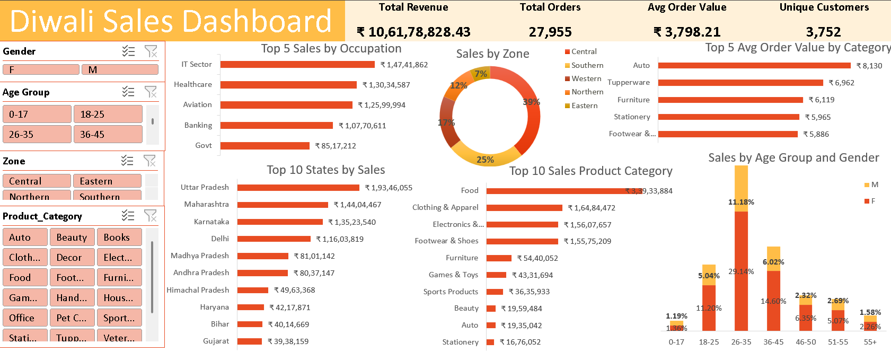

# Diwali Sales Analysis (Excel Dashboard)

An end-to-end Excel project: clean a raw Diwali sales file, analyse it with PivotTables, and present the results in an interactive dashboard.

| File | What it is |
|---|---|
| `raw_diwali_sales_data.xlsx` | Original data, before cleaning |
| `diwali_sales_analysis.xlsx` | Final workbook with 3 sheets: **Data** (cleaned), **Pivots** (calculations), **Dashboard** (final output) |

---

## 1. Business Problem

A retail company sold products to customers during the Diwali festive season. Diwali is the biggest sales period of the year, so the management wants to plan **next Diwali's** marketing, stock and budget using facts, not guesses.

The dashboard is built to answer these questions:

1. **How big was the season?** (Total revenue, orders, average order value, unique customers)
2. **Who is buying?** Which gender and age groups bring the most revenue?
3. **What is selling?** Which product categories earn the most, and which sell at a high order value?
4. **Where is the money coming from?** Which states and zones are strongest, and which are weak?
5. **Which customer jobs (occupations) spend the most?**

**Goal:** Use the answers to decide *who to target, what to stock, and where to focus* in the next Diwali campaign.

---

## 2. Dataset

- **Source file:** `raw_diwali_sales_data.xlsx`, sheet `Data`
- **Size:** 11,239 rows × 15 columns (raw) → 11,231 rows × 14 columns (cleaned)
- **One row =** one customer purchase record
- **No date column**, so this analysis shows *who / what / where*, not trends over time.

| Column | Meaning |
|---|---|
| User_ID, Cust_name | Customer ID and name |
| Product_ID | Product bought |
| Gender, Age, Age Group | Customer profile (F/M, exact age, 7 age bands from 0-17 to 55+) |
| Marital_Status | 0 = single, 1 = married |
| State, Zone | Customer location (16 states, 5 zones) |
| Occupation | Customer's job sector (15 sectors) |
| Product_Category | Product type (18 categories) |
| Orders | Number of orders |
| Amount | Sales value (₹) |
| Avg_order_value | Calculated column: `Amount / Orders` |

---

## 3. Data Cleaning (Raw → Final)

Comparing the two files shows these changes:

| Problem in raw file | Fix in final file | Why it matters |
|---|---|---|
| 8 duplicate rows | Removed (11,239 → 11,231 rows) | Duplicates count the same sale twice and inflate revenue |
| `Status` column was completely empty (0 of 11,239 values) | Column deleted | An empty column adds no value and clutters the table |
| `Andhra Pradesh` had a hidden non-breaking space in 811 rows | Replaced with a normal space | Without this, Excel can treat the same state as two different values in a PivotTable |
| Data was a plain range | Kept as an Excel Table named `DiwaliSalesTable` | Pivots and formulas update automatically and use readable names |

After cleaning: no blank cells, no duplicates, and all text columns are consistent.

---

## 4. Analysis Method

1. **Excel Table** (`DiwaliSalesTable`) as the single source of data.
2. **Calculated column** `Avg_order_value = Amount / Orders`.
3. **Data Model + measures** for *Distinct Count of User_ID* (unique customers) and *AOV* (total amount ÷ total orders).
4. **8 PivotTables** on the `Pivots` sheet: KPIs, Gender, Age × Gender, Product Category, Category AOV, State, Zone, Occupation.
5. **6 charts + 4 slicers** on the `Dashboard` sheet.

---

## 5. Dashboard

**KPI cards**

| Total Revenue | Total Orders | Avg Order Value | Unique Customers |
|---|---|---|---|
| ₹10.62 crore (₹106,178,828) | 27,955 | ₹3,798 | 3,752 |

**Charts**

| # | Chart | Type |
|---|---|---|
| 1 | Sales by Age Group and Gender | Column |
| 2 | Sales by Product Category (top 10) | Bar |
| 3 | Top 10 States by Sales | Bar |
| 4 | Average Order Value by Category (top 5 categories) | Bar |
| 5 | Sales by Zone | Doughnut |
| 6 | Top 5 Sales by Occupation | Bar |

**Slicers (click to filter the dashboard):** Age Group, Gender, Zone, Product Category.



---

## 6. Key Insights

**Who buys**
- **Women drive the sales:** 70% of revenue (₹7.43 crore) vs 30% from men. Order value is almost the same (₹3,804 vs ₹3,785), so women win on *volume of buyers*, not bigger baskets.
- **Age 26–35 is the core group:** 40.3% of revenue. Ages 18–45 together give 77%.
- **Single customers spend more in total** (58.5% of revenue) than married customers (41.5%).

**What sells**
- **Food is #1** with 32% of revenue (₹3.39 crore), followed by Clothing & Apparel (15.5%), Electronics & Gadgets (14.7%) and Footwear & Shoes (14.7%). These 4 categories make **77%** of all revenue.
- **Order value differs a lot by category.** Clothing is high in volume but low in value (₹2,487 per order). Furniture (₹6,119), Footwear (₹5,886) and Food (₹5,554) earn much more per order. Small categories like Auto (₹8,130) and Tupperware (₹6,962) have very high order values.
- **Weak categories:** Office, Veterinary, Pet Care and Hand & Power Tools each bring less than 0.5% of revenue.

**Where the money comes from**
- **Top 3 states = 44.5% of revenue:** Uttar Pradesh (₹1.93 crore, 18.2%), Maharashtra (13.6%) and Karnataka (12.7%). The top 10 states give 86.8%.
- **Central zone leads with 39.2%**, then Southern (25.1%) and Western (17.3%). **Eastern zone is the weakest at 6.6%.**
- Kerala, Jharkhand, Uttarakhand, Rajasthan, Punjab and Telangana are small markets (each 1–4% of revenue).

**Customer jobs**
- **IT Sector (13.9%), Healthcare (12.3%), Aviation (11.9%), Banking (10.1%) and Govt (8.0%)** are the top 5 occupations and together give 56.2% of revenue.

---

## 7. Recommendations

1. **Target women aged 26–35 first.** Run the biggest festive ads, offers and gift bundles for this group.
2. **Stock Food, Clothing, Electronics and Footwear early and deeply.** They bring over three-quarters of revenue.
3. **Raise order value in Clothing** (high volume, ₹2,487 per order) using combo offers and "buy more, save more" deals.
4. **Push high-value categories** (Furniture, Footwear, Auto) with EMI offers or premium bundles to lift the average order value.
5. **Protect the top states** (UP, Maharashtra, Karnataka, Delhi) with strong delivery and stock, and **test growth campaigns in the Eastern zone** and the small states.
6. **Run occupation-based offers** for IT, Healthcare, Aviation and Banking customers.
7. **Review very low-revenue categories** (Office, Veterinary, Pet Care): promote them with bundles, or reduce their stock.
8. **Grow male buyers (30%)** with targeted gift campaigns.

---

## 8. Limitations

- There is **no date/time field**, so daily or weekly Diwali trends cannot be analysed.
- There is **no cost or profit field**, so the analysis is about *revenue*, not profit.
- Customers with more than one row are counted once in *Unique Customers* (3,752), so the 11,231 rows are purchase records, not customers.

---

## 9. Tools & Skills Used

Microsoft Excel: Excel Tables, calculated columns, data cleaning, PivotTables, Data Model measures, PivotCharts, Slicers, dashboard design.

---

## 10. How to Use This Repository

1. Download `diwali_sales_analysis.xlsx` and open it in Excel (desktop version recommended, as slicers and the Data Model need it).
2. Go to the **Dashboard** sheet and click the slicers to filter.
3. Open `raw_diwali_sales_data.xlsx` to see the data before cleaning.

## Repository structure

```
diwali_sales_project/
├── raw/
|   └── raw_diwali_sales_data.xlsx
├── excel/
|  └── diwali_sales_analysis.xlsx
├── images/
│   └── dashboard.png
└── README.md
```
## Author

**Vishul Kaushik**: aspiring data analyst
🔗 [LinkedIn](www.linkedin.com/in/vishul-kaushik-523a70425) ·
📧 [mail](mailto:vkds9368@gmail.com) ·
💻 [GitHub](https://github.com/Vishul-DS)

*If you found this useful, a ⭐ on the repo is appreciated.*